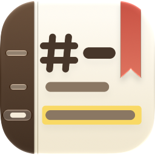

<p align="center"></p>

<h1 align="center">MDよみとき</h1>

<p align="center">AI が書き換える Markdown を、すばやく読み解く macOS アプリ</p>

---

Claude Code などの AI エージェントが書いたり書き換えたりする日本語の Markdown を、開いたまま見張って、変わったところをすぐに示すリーダー兼エディタです。「読む・探す・少し直す」のための道具として作っています。

- **変わったところがすぐ分かる**：ファイルが書き換わると自動で読み直し、変わった段落・消えた行に印を付けます。⌘J で変更箇所を順に回れます。
- **日本語の Markdown をきれいに読める**：GitHub と同じ表示に加えて、日本語で崩れがちな太字や全角スペースも正しく表示します。
- **日本語のあいまい検索**：ひらがなとカタカナ、全角と半角の違いを気にせず探せます。
- **Mac のアプリとして自然に使える**：AppKit と SwiftUI で作ったネイティブアプリです。タブ・ダークモード・トラックパッドなど、macOS の作法に沿っています。

## 機能

### 変更を追いかける

- **自動で読み直す**：外でファイルが保存されると、すぐに表示を更新します。読んでいた位置はそのまま保ちます。
- **変更の印**：
  - 変わった段落の左に、オレンジの線を引きます。前回「確認済み」にしてからの変更は淡く、いちばん新しい更新は濃くなります。
  - 消えた行は、赤い線と「−3行」のような印で示します。
  - 印にマウスを載せると、変更前の内容や消えた行が吹き出しで出ます。
- **変更の一覧と移動**：
  - サイドバーの「変更」欄に変更箇所を並べ、クリックでそこへ移動します。
  - ⌘J／⇧⌘J で次／前の変更箇所へ移動します。
  - プレビューの右端の目盛りにも、文書全体のどこが変わったかが並びます。
- **確認済み**：読み終えたら「確認済み」にして、そこから先の変更だけを示します。git の HEAD と比べることもできます。
- **いつ更新されたか**：
  - ステータスバーに「たった今」「3分前」などの最終更新と、開いてから外で更新された回数を出します。
  - 1分以内の更新はオレンジで示すので、AI がまだ書いている途中かどうかの目安になります。
- **見えていないタブも分かる**：裏のタブやしまったウインドウの文書が更新されると、タブにオレンジの点が付き、Dock のアイコンに件数が出ます。
- **編集中でも安心**：自分が直している途中に外で書き換えられたら、どちらを残すか選べます。

### 読む

- **GitHub と同じ Markdown**：
  - 表・タスクリスト・脚注・取り消し線・自動リンクに対応しています。
  - アラート（`> [!NOTE]` `> [!WARNING]` など）も表示します。
  - 見出しのリンク（`#見出し`）も GitHub と同じ規則で付けます。
- **日本語のための補正**：
  - `**「重要」**` のように、標準の規則では太字にならない日本語の太字を正しく太字にします。
  - 全角スペースで書かれた見出し（`#　見出し`）や箇条書きも、その通りに表示します。
  - 文字はヒラギノで、行間と禁則処理を日本語の文章向けに整えています。
- **表**：
  - 横に長い表は表だけを横にスクロールできます。
  - 長い表は、見出し行が画面の上に残ります。
- **コード**：言語ごとに色を付けます。マウスを載せると言語名とコピーのボタンが出ます。
- **Mermaid の図**：` ```mermaid ` のコードを図にして表示します。
- **そのほかの表示**：
  - 文書の先頭のフロントマター（`---` で囲んだ設定）は、折りたたんで表で見せます。
  - 画像は、文書からの相対パスでも表示します。インターネット上の画像を読み込まないようにもできます。
- **リンク**：
  - ほかの Markdown ファイルへのリンクは、新しいタブで開きます。`other.md#見出し` ならその見出しへ移動します。
  - Web のリンクはブラウザで開きます。
- **読みやすさの調整**：文字の大きさ（⌘+／⌘−）と、本文の幅（狭い・標準・広い・ウインドウの幅）を変えられます。
- **プリントと PDF**：ダークモードのときも、紙に合った明るい配色で出力します。

### 探す・移動する

- **あいまい検索**（⌘F）：
  - ひらがなとカタカナ、全角と半角、大文字と小文字の違いを無視して探します。
  - 一致した箇所は本文と右端の目盛りに出ます。
- **見出し一覧**：今読んでいる見出しに印が付き、変更のある節には点が付きます。
- **付箋**（⌘D）：
  - 気になる段落に付箋を付けておけます。付箋の一覧から、すぐ戻れます。
  - AI が前後を書き換えても、付箋は同じ段落についていきます。
- **戻る／進む**：見出しや変更へ移動する前の位置に戻れます。キー（⌘[／⌘]）のほか、トラックパッドのスワイプやマウスの戻るボタンでも動きます。
- **位置を覚える**：ファイルごとに読んでいた位置を覚えていて、次に開いたときにそこから表示します。

### 少し直す

- **エディタ**（⌘E で切り替え）：
  - 見出しや太字などに色や太さを付けて表示し、全角スペースも見える形で示します。
  - 日本語入力の変換中に表示が乱れないようにしています。
- **書式**：見出し・太字・斜体・リンク・リスト・引用・コードブロック・表を付けたり外したりできます。メニュー・右クリック・ショートカット（⌘B・⌘I・⌘K・⌘1〜3 など）のどれからでも使えます。
- **置換**（⌥⌘F）：あいまい検索で見つけた箇所もまとめて置き換えられ、⌘Z の1回で戻せます。
- **チェックボックス**：プレビューのタスクリストをクリックすると `[ ]`／`[x]` を切り替えて保存します。
- **元の形式のまま保存**：
  - 文字コード（UTF-8・Shift_JIS）と改行コードは、元のファイルのまま書き戻します。
  - 保存は一度に置き換える方式なので、書きかけのファイルが残りません。
- **文字数**：空白を除いた文字数を、本文全体と選択範囲について出します。

### ファイルとタブ

- **タブとウインドウ**：複数のファイルは macOS 標準のタブで開きます。閉じたタブは ⇧⌘T で開き直せます。
- **最近使ったファイル**（⇧⌘O）：
  - 名前やプロジェクト名で絞り込んで、すぐに切り替えられます。
  - よく使うファイルはピン留めできます。
- **前回の続きから**：前回開いていたタブとウインドウの配置を、次の起動で元に戻します。
- **いろいろな開き方**：Finder から開く、Dock のアイコンやウインドウにドロップする、のどちらでも開けます。同じファイルをもう一度開いたときは、開いているタブを前に出します。
- **Quick Look**：Finder でファイルを選んでスペースキーを押すと、アプリと同じ見た目で中身を確かめられます（表・日本語の太字・コードの色付けつき）。画像と Mermaid の図は、アプリで開いたときに表示します。
  - ほかにも Markdown の Quick Look を持つアプリが入っていると、そちらが使われることがあります。そのときは「システム設定」→「一般」→「ログイン項目と機能拡張」→「Quick Look」で、使わない方をオフにしてください。

## Mac らしさ

Web の技術でできたアプリではなく、macOS の部品で作っています。

- **ネイティブの部品**：
  - ウインドウ・タブ・ツールバー・サイドバー・設定ウインドウ（⌘,）は、macOS 標準のものです。
  - 検索バーは Safari の「ページ内を検索」と同じ形にしています。
  - すべての操作はメニューにあり、ショートカットもメニューで確かめられます。
- **システムの見た目に合わせる**：
  - 文字はシステムのフォント（日本語はヒラギノ）、色はシステムの色を使います。
  - ライト／ダークモードと、システム設定のアクセントカラーに合わせて配色が変わります。
  - プレビューの背景もウインドウになじむように透かしています。
- **macOS 26 のアイコン**：アイコンは Icon Composer 形式で作りました。macOS 26 ではガラスのような質感で表示され、ダークモードや色付きのアイコンにも対応しています。macOS 15 では通常のアイコンを使います。
- **トラックパッドとマウス**：
  - 2本指／3本指のスワイプで戻る／進むができ、Safari のように矢印が出てきます。
  - マウスの戻る／進むボタンにも対応しています。
- **軽くて速い**：大きな文書でも、読み込みや更新の重い処理は裏で行うので、画面が固まりません。
- **安心して配れる形**：Apple の公証を受けた Universal アプリ（Apple シリコン・Intel）です。アップデートは [Sparkle](https://sparkle-project.org) で、署名を確かめてから入れます。
- **データは手元だけ**：
  - 文書の内容をどこかへ送ることはありません。
  - インターネットに接続するのは、アップデートの確認と、文書の中のインターネット上の画像の読み込みだけです。画像の読み込みは止められます。

## 動作環境

macOS 15 Sequoia 以降（Apple シリコン・Intel）

## インストール

1. [MDYomitoki.dmg](https://github.com/efukan/md-yomitoki/releases/latest/download/MDYomitoki.dmg) をダウンロードします（いつも最新版が落ちてきます。これまでの版と変更内容は [Releases](https://github.com/efukan/md-yomitoki/releases) にあります）。
2. dmg を開き、「MDよみとき」を「アプリケーション」フォルダへドラッグします。
3. 「アプリケーション」フォルダから起動します。

新しい版が出ると、起動中にお知らせが出ます（1日1回確かめます）。今すぐ確かめるときは、メニューの「MDよみとき」→「アップデートを確認…」を選びます。自動でダウンロードしてインストールするかどうかは、設定（⌘,）で選べます。

## 使い方

1. Markdown ファイルを ⌘O で開きます。アプリのアイコンやウインドウにドロップしても開けます。
2. AI エージェントに書かせている文書を開き、横に置いておきます。書き換わるたびに表示が追いかけて、変わったところに印が付きます。
3. ⌘J で変更箇所を順に確かめ、読み終えたら「確認済み」にします。

Finder で .md ファイルをダブルクリックしたときに MDよみとき で開くようにするには、設定（⌘,）の「Markdown ファイル」で「MDよみとき にする」を押します。Finder でファイルを選び、「情報を見る」の「このアプリケーションで開く」で MDよみとき を選んで「すべてを変更」を押しても同じです。

不具合や要望は、「ヘルプ」メニューの「不具合の報告・要望（メール）…」か「不具合の報告・要望（GitHub）…」から送れます。メールの宛先は efukan.dev@gmail.com です。GitHub で送るにはアカウントが必要です。

| キー | 操作 |
|---|---|
| ⌘O／⇧⌘O | 開く／最近使ったファイル |
| ⌘E | プレビューとエディタの切り替え |
| ⌘J／⇧⌘J | 次の変更箇所／前の変更箇所 |
| ⌘F／⌘G／⇧⌘G | 検索／次を検索／前を検索 |
| ⌥⌘F | 置換（エディタ） |
| ⌘D | 付箋を付ける／外す |
| ⌘[／⌘] | 戻る／進む |
| ⌃⌘S | サイドバーを表示／隠す |
| ⌘+／⌘−／⌘0 | 拡大／縮小／実際のサイズ |
| ⌘B／⌘I／⌘K | 太字／斜体／リンク（エディタ） |
| ⌘1〜⌘3 | 見出し 1〜3（エディタ） |
| ⌘S | 保存 |
| ⌘P | プリント |
| ⌘W／⇧⌘T | タブを閉じる／閉じたタブを開き直す |

## ソースからビルドする

Xcode（macOS 15 SDK 以降）と [XcodeGen](https://github.com/yonaskolb/XcodeGen) が必要です。署名には `Config/App.xcconfig` の `DEVELOPMENT_TEAM` のチームの「Apple Development」証明書を使うので、先に自分の Apple のチーム ID に書き換えてください。

```sh
brew install xcodegen
make run    # ビルドして起動
make test   # ユニットテスト
```

開発中のビルド（Debug）は自動アップデートを行いません。仕組みや設計の詳しい説明は [CLAUDE.md](CLAUDE.md) にあります。

## ライセンス

[MIT License](LICENSE) © 2026 efukan

次のオープンソースソフトウェアを同梱しています。ライセンスの全文は、アプリの「MDよみとき について」と [Credits.html](MDYomitoki/Resources/Credits.html) にあります。

- [cmark-gfm](https://github.com/swiftlang/swift-cmark)（Markdown の解析）：BSD 2-Clause
- [Sparkle](https://sparkle-project.org)（自動アップデート）：MIT
- [highlight.js](https://highlightjs.org)（コードの色付け）：BSD 3-Clause
- [Mermaid](https://mermaid.js.org)（図の描画）：MIT
